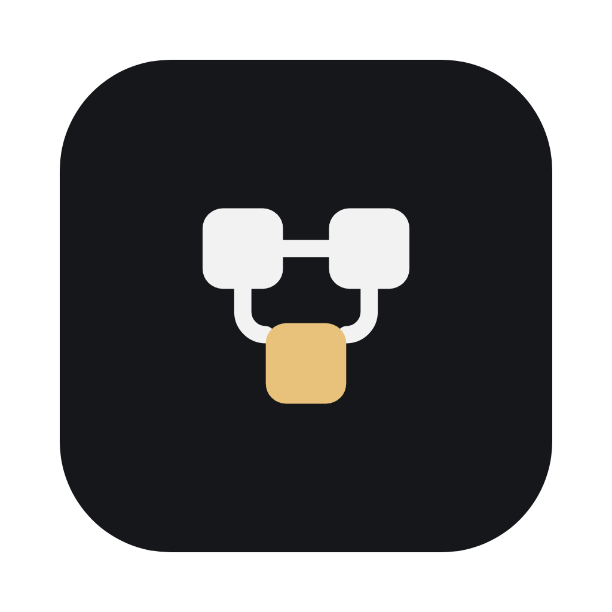

<p align="center">
  
</p>

# CodeCanvas IDE

A desktop IDE for TypeScript and JavaScript where every file can also be edited as a zoomable
diagram. Every function, class, variable and import is a block; usages are drawn as lines between
them. Anything you change on the canvas is written back to the text file, and the other way around:
the text stays the source of truth.

<p align="center">
  
</p>

Everything else (the explorer, search, source control, the terminal, extensions) works as in VS Code.

## Why CodeCanvas

I remember places much better than facts. IDEs already give me some of that: folders, the order of
functions in a file, which file calls which. CodeCanvas adds one more dimension. A file becomes a
room you arrange. Blocks of code aren't only above or below each other; they are also left and
right of each other, and the connections between them are drawn.

I want to change how we see code: not colored text on a screen, but machines connected to each
other, each with its own place and its own job.

Most code-visualization tools throw a huge diagram of everything at you. You don't remember it,
because you didn't arrange it. You can't act on it. And when the code changes, you can't tell what
moved. In CodeCanvas you place every block yourself, the layout is saved with the repo, you edit on
the canvas, and Show Changes tells you what changed.

And it is still an IDE. You write, run and debug code as usual. The canvas is a visual layer that
organizes your code without getting in your way.

## What you can do

- **Open a TypeScript or JavaScript file as a canvas.** That is the default; "Open as Text" in the
  title bar switches to the text editor, and the setting `codeCanvas.openFilesAsCanvas` turns the
  default off. JavaScript works the same way, without the types (CommonJS `require()` too).
- **Work with React.** React files are recognized by themselves, and the canvas toolbar shows the
  language (JS, TS, React JS/TS/JSX/TSX). Components are their own blocks, each `useState` is a
  state block inside its component, named after its value and its setter (`coupon / setCoupon`),
  `<Child />` draws a line to the child, and components are laid out as a tree.
- **Edit a block** by double-clicking it. A Monaco editor opens on the block's own lines of the
  file, so IntelliSense, hovers and error squiggles work as in a text editor. Undo, save and unsaved
  changes are shared with the text editor. Enter twice after the block's last line (its `}`, or
  `const fee = 2;`) closes the editor.
- **See errors on blocks.** Errors from Problems put a red marker with a count on the block.
- **Follow usages**, also across files. The references list shows the blocks that use a block and
  the blocks it uses; click one to open that file at the block. ⌘-click an import block to open the
  file it imports, and ⌘[ / ⌘] go back and forward.
- **Rename with F2.** Every usage changes, in every file; one undo reverts all of it.
- **Create blocks by typing.** Start typing on the canvas, or double-click empty space: an empty
  block opens, and what you type goes into the file and becomes a block there. Right-click empty
  space to pick what to create (function, constant, class, interface, type, enum, component).
- **Copy, paste, duplicate and delete blocks.**
- **Keep your layout.** Blocks stay where you put them, whatever their order in the file. Once you
  arrange something, positions are saved in `.codecanvas/` in the workspace folder, to commit so
  your team sees the same layout. Moving blocks is an undo step: ⌘Z moves them back, in order with
  your text edits.
- **Read a new file easily.** A file without a saved layout is arranged by readability rules:
  imports on the left, default exports on the right, constants and types at the top, a getter above its setter, and a function on
  the left of the functions it calls, in call order. "Arrange" applies the rules again.
- **Review changes.** "Show Changes" compares the file with its last commit: unchanged blocks are
  desaturated, added and changed blocks get a chip, removed blocks show in red where they were.
- **Resolve merge conflicts** on the canvas: conflicted blocks are marked, and Keep current /
  incoming / both resolve them. VS Code's own conflict actions also work in the block editor.
- **See a feature's flow.** Right-click a function (on the canvas or in the code) → Open Flow shows
  the functions connected to it, across files: its callers up to the entry points, such as the route
  that registers a handler, and its calls down to the end (router → controller → service →
  repository). Each file is a box; a loop is a line going back with a "loop" chip; shared helpers are
  folded. Edit blocks there with IntelliSense from their own file, or create a function in a file's
  box. A flow is temporary until you change it; then it is saved in `.codecanvas/flows/` and listed in
  the Flow views panel and in Go to Anything. `codeCanvas.flow.maxFunctions` sets its size limit.
- **Read JSON files.** A `.json` or `.jsonc` file stays text, with a few marks on top: the path of
  the value under the cursor (with Copy path), its type, a key count on folded objects, a Structure
  view of the top-level keys, and a filter that dims what does not match.

The project follows the folder's config files (path aliases, `baseUrl`, `extends`), also in
monorepos: every package's files use that package's `tsconfig.json`, and packages that import each
other by name are linked.

## Build and run (macOS)

There are no releases yet; build it from source. You need the Xcode command line tools, Python 3,
[nvm](https://github.com/nvm-sh/nvm) and about 6 GB of disk.

```sh
git clone https://github.com/d-feliz/codecanvas-ide
cd codecanvas-ide
nvm install                 # the Node version in .nvmrc
npm i -g pnpm@12.16.0       # the version in package.json "packageManager"
pnpm ci
pnpm run compile
pnpm run electron
./scripts/code.sh           # starts CodeCanvas
```

To make an app you can keep in Applications, run `pnpm run gulp vscode-darwin-arm64` after
compiling. It's written to `../VSCode-darwin-arm64/CodeCanvas.app`. The app isn't signed, so the
first time, open it with **Open Anyway** in System Settings → Privacy & Security. More notes are in
[CODECANVAS.md](CODECANVAS.md).

## License

[MIT](LICENSE.txt). Code-OSS is copyright (c) Microsoft Corporation; the CodeCanvas changes are
copyright (c) CodeCanvas contributors.
